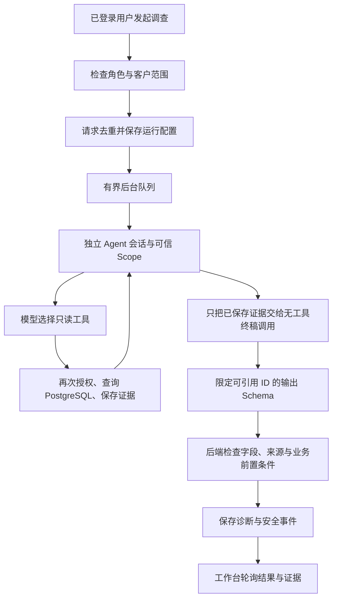

# 只读调查闭环（2026-11-03）

本轮实现 G3 中的调查运行、结果校验和前端入口。G3 仍为 AMBER：已用真实 PostgreSQL 与本地模型验证两个开发案例，但还没有真实向量手册检索、修复建议分支或完整登录页面验收。

## 一次调查经过什么



AgentScope 提供模型推理循环、流式工具调用和结构化输出。本项目新增的是客户授权、运行生命周期、证据记录、约束与业务验证；没有另写工具推理循环。每次调查使用独立 Agent、Toolkit 和内存状态，不挂通用聊天的长期记忆、Skills 或任意 MCP 工具。

## HTTP 与界面

- `GET /support/capabilities`：读取调查是否启用，要求现有登录态。
- `POST /support/cases/{caseId}/runs`：请求体为 `{"requestKey":"client-generated-unique-key"}`，可选 `question` 不超过 2000 字符。不能选择用户、客户、模型或主要业务对象。
- `POST /support/runs/{runId}/cancel`：只允许当前仍有调查权限的运行发起人取消。
- 已有运行、证据和事件 GET 接口负责回放；读取不会重新启动模型。

相同请求键和配置返回同一个运行；配置改变时返回冲突。后端以数据库状态变更领取运行，防止重复模型执行。界面发起、停止并每两秒轮询，终态不被较早的轮询响应改回运行中。关闭页面不代表取消调查。

## 谁负责什么

| 部分 | 负责的判断 |
|---|---|
| 后端 | 当前用户是否可调查该工单；目标对象；工具白名单；查询范围；预算；引用是否属于本次运行；动作条件 |
| 调查模型 | 选择只读工具和检索问题，收集与问题有关的证据 |
| 终稿模型调用 | 从已保存证据产生结构化诊断；没有工具或业务写权限 |
| 人工与后续评测 | 文本是否真正受到证据支持、是否切题、缺失信息是否充分 |

调查模型的自由文本草稿不作为证据，也不传给终稿调用。这样可以避免它编造的“工具结果”污染终稿；当前真实开发记录中确实观察到了这种失败。

## 约束与失败处理

- 仅支持 `SUBSCRIPTION_ACTIVATION`。API 授权场景返回配置未完成，不偷用订阅工具。
- 四个工具为 `get_case_context`、`get_subscription_status`、`list_subscription_events`、`search_runbooks`，均只读。
- 前三个不接受模型参数。时间线固定为最近七天、最多 20 条，并保留 `truncated`；手册只接受 `query`，检索数量固定为 3。身份和对象来自服务端 Scope。
- 一个模型工作线程、最多 8 个等待任务；模型和排队共享两分钟预算；最多 12 次实际工具调用，每个工具十秒超时。
- 订阅在独立调度器上启动，取消也交由调度器处理，避免同步 SDK 订阅或关闭网络流阻塞 HTTP 取消请求。单元检查模拟了阻塞订阅，验证超时仍能收尾。
- 取消先保存 `INTERRUPTED`，迟到的模型结果不能覆盖终态。进程关闭时中断本进程工作；读取超过三分钟仍未结束的本版本运行时，标记过期。过期记录不从任意模型步骤自动恢复。
- 终稿只调用一次、没有工具。输入证据 JSON 的 UTF-8 大小上限为 5000 字节，防止把超长手册静默塞进小上下文；超过时明确失败，后续再设计更好的证据选择。
- 终稿 Schema 使用实际证据 ID 枚举；没有手册证据时，`runbookEvidenceIds` 的最大数量是 0。后端仍独立检查引用，不能依靠模型供应商的 Schema 实现代替权限验证。
- 所有事实需要引用本次运行中的证据；`NO_ACTION_NEEDED` 必须引用观察到 ACTIVE 的订阅快照；`NEEDS_INFORMATION` 需要解释缺失项。
- 校验器支持检查修复建议的付款状态、未截断的确认/失败事件、精确匹配的人工登记手册策略。本轮无工具终稿采用保守策略，不启用业务修复，也没有生成审批或执行操作。
- 格式错误、越权、工具失败与模型失败都保留失败状态，不伪装为“没有数据”。事件不保存内部思维链或原始异常中的数据库信息。

引用存在不等于文本一定受到引用支持。本轮没有自动验证任意自然语言事实的语义蕴含。

## 模型与启用方式

Qwen3 4B 仍是原有本地聊天默认；本轮通过调查开发检查的是 `resolveops-llama:3b`（Llama 3.2 3B，Q4_K_M，约 2GB）。两者均在本机运行，无 API Token 费用。模型配置、提示词和约束同时迭代，因此这些开发记录不是公平的跨模型能力排名。

```bash
scripts/resolveops/local-model.sh setup-llama
RESOLVEOPS_LOCAL_MODEL=resolveops-llama:3b scripts/resolveops/local-model.sh chat
```

调查默认关闭。完成现有 Ragent 的数据库、登录和存储配置后，启动应用时选择 `local-model` profile，并显式设置：

```bash
export RESOLVEOPS_LOCAL_MODEL=resolveops-llama:3b
export RESOLVEOPS_REASONING_EFFORT=none
export RESOLVEOPS_INVESTIGATION_ENABLED=true
```

这不启动任何容器，不补齐向量索引，也不表示整个 Web 应用已在本机部署完成。

Llama 基础 manifest：`a80c4f17acd55265feec403c7aef86be0c25983ab279d83f3bcd3abbcb5b8b72`。
项目 manifest：`2cf0e7cfff162e5a4a719199aa61a6e7ea312d95751f2892836ac5c70ed8c08f`。
Ollama 版本 `0.40.13`；项目模型为 8K 上下文、每次 1024 Token 输出上限。

## 实际验收范围

普通检查：44 项通过，其中含真实原生 PostgreSQL 授权/领域检查、11 项上游 AgentProvider 回归和本轮生命周期、诊断、工具目录检查。默认跳过三项显式启用的集成检查，CI 不连接本机模型。九模块编译、前端 TypeScript 与生产构建分别检查。

```bash
scripts/resolveops/check.sh -pl agent -am \
  '-Dtest=Support*Test,RunbookEvidenceSearchTest,LocalModelConfigurationTest,ReActAgentProviderTest' \
  -Dsurefire.failIfNoSpecifiedTests=false test
```

独立的 PostgreSQL 测试实例就绪后，真实链路检查为：

```bash
RESOLVEOPS_INVESTIGATION_TEST=1 \
RESOLVEOPS_INVESTIGATION_MODEL=resolveops-llama:3b \
RESOLVEOPS_TEST_DB_URL=jdbc:postgresql://127.0.0.1:55433/postgres \
scripts/resolveops/check.sh -pl agent -am \
  '-Dtest=SupportInvestigationIntegrationTest' -Dsurefire.failIfNoSpecifiedTests=false test
```

该检查使用专用本机 PostgreSQL 的 `postgres` 测试账户，在随机 schema 中创建合成数据并只删除自己的 schema。不要把命令指向共享业务数据库。

| 检查 | 实际依赖与结果 |
|---|---|
| 已开通订阅 | 真实模型、查询、授权、证据与诊断落库；`COMPLETED / NO_ACTION_NEEDED` |
| 待开通但无可用手册 | 真实模型与领域服务，手册索引未配置；`COMPLETED / HANDOFF`；操作表仍为空 |
| 取消 | 真实 PostgreSQL + 故意不结束的模型流替身；验证中断、流取消和重复请求不重启 |

两个模型案例使用真实模型响应，业务服务没有被 Mock。测试的登录上下文由测试提供，没有穿过浏览器与 SaToken；模型客户端的 spy 只记录工具名称，不替换响应。第三项是明确标注的故障注入检查。

部分合成开发记录保存在 [evidence/investigation-v5.json](evidence/investigation-v5.json)。全部本机原始记录位于 `agent/target/investigation-*.json`，不自动上传。没有从两个案例推算成功率、用户收益或生产性能。

## 真实失败与下一步

1. 单工具兼容性通过，不代表完整调查通过：Qwen 在长提示/多工具下曾用完输出预算而没有可用诊断。
2. 资源名泄漏预期答案：早期 `sub-active` 让小模型猜中状态却没有读取它；后端拒绝了无状态证据的结论，后续改成中性资源名。
3. 草稿污染：模型曾编造手册证据并纠缠错误参数。最终只使用落库证据，限制引用 ID，并把不需要的参数移出模型接口。
4. 只用阻塞等待计时不够：同步订阅可能先占住线程。现在用独立订阅/取消调度和一个涵盖排队的总截止时间。

已通过的开发记录仍出现无关的时间戳事实，以及 `NO_ACTION_NEEDED` 中夹带占位缺失项等质量问题。形式检查通过不表示终稿质量验收通过；需要在 G6 中加入切题性、矛盾与缺失信息 rubric，不能将现有结果包装为生产质量。

下一步：真实本地 embedding/pgvector 手册入库与检索、精确登记的 SOP、真实修复建议案例；再验证完整登录界面和冻结评测。G4 的审批与写入服务没有在本轮实现。
