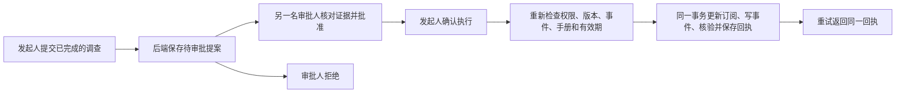

# 人工审批与订阅修复

ResolveOps 从已完成的订阅调查生成提案。提案固定了目标、工单与订阅版本、付款和失败事件、手册证据及 15 分钟截止时间。审批和执行都提交同一个提案哈希。工作台展示当前身份可以执行的操作。



审批和执行是两个操作。原发起人拥有审批角色也不能批准自己的提案。服务在执行事务中锁住工单、当前发起人和审批人的授权、目标订阅及修复前提，使用订阅版本作为条件更新。数据库通过提案唯一性、业务操作键及事件约束阻止重复开通。工单关闭仍是人工决定。

修复写入 ResolveOps 自己的合成订阅表。审计记录保存提案、操作者、决策和操作回执。模型调用仍只使用调查工具。执行可以独立于模型服务运行。

## 本机演示

1. 在独立本地库应用 [261117_support_repair.sql](../../resources/database/upgrades/v2.0.0/261117_support_repair.sql)。空库用包含该变更的完整初始化 SQL。
2. 在本地模型 profile 设置 `RESOLVEOPS_REPAIR_ENABLED=true`。其他 profile 可直接设置 `support.repair.enabled=true`。
3. 给同一合成租户的两个真实登录用户分别配置 `OPERATOR`、`APPROVER`。用 Operator 完成一个返回 `PROPOSE_REPAIR` 的调查并提交提案。
4. 用 Approver 打开同一工单、选中原调查，核对规则和证据后批准。切回 Operator，刷新提案并确认执行，工作台将显示新版本与修复事件。

HTTP 入口为 `GET/POST /support/runs/{runId}/repair`，以及同路径下的 `POST /approve`、`POST /reject`、`POST /execute`。后三者接收 `payloadHash`。身份来自已有登录上下文，提案业务字段从数据库获取。遇到网络中断时可以刷新提案查看回执，或用相同哈希重试。

## PostgreSQL 验收

```bash
scripts/resolveops/check.sh -pl support -am '-Dtest=SupportRepairTest' \
  -Dsurefire.failIfNoSpecifiedTests=false test
```

| 检查 | 预期结果 |
|---|---|
| 不同角色通过 HTTP 提交、批准、执行 | 一次订阅更新、一条修复事件和包含版本的回执 |
| 同一提案并发提交、执行、丢失响应后重试 | 返回同一提案和回执，审计无重复记录 |
| 两个调查同时修复同一订阅版本 | 一笔成功，另一笔因版本变化被拒绝 |
| 自批、哈希不匹配、人工拒绝、跨租户访问 | 修复流程无法继续 |
| 工单或订阅版本变化、审批过期、权限撤销、手册撤销 | 执行前的重新校验阻止写入 |
| 最后一步审计写入失败 | 订阅、事件和回执均回滚，可以安全重试 |

端到端的 HTTP 测试使用 PostgreSQL、应用的事务拦截器和测试登录上下文。浏览器与 Sa-Token 的完整登录演示仍属于 G7。模型评测与这组事务测试分开。
